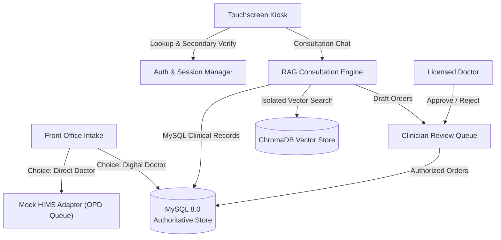

# Digital Doctor (டிஜிட்டல் டாக்டர்)
### Hospital Self-Service AI Consultation Kiosk with Clinician Oversight

[](LICENSE)
[](https://fastapi.tiangolo.com)
[](https://react.dev)
[](https://docs.docker.com/compose/)
[](docs/TESTING.md)

**Digital Doctor** is an enterprise-grade hospital self-service consultation kiosk designed for outpatient departments (OPD). Patients can look up their registration, verify their identity via secondary factors, review authorized clinical history, upload medical reports, and engage in an AI-guided consultation grounded in their medical records and hospital clinical guidelines. 

All clinical recommendations (prescriptions, laboratory investigations, and imaging scans) are generated strictly as **draft suggestions** and require explicit digital sign-off by a licensed attending physician via the **Clinician Review Queue** before any orders can be issued or dispensed.

---

## 1. Table of Contents
1. [Core Features](#2-core-features)
2. [Architectural Highlights](#3-architectural-highlights)
3. [Technology Stack](#4-technology-stack)
4. [Prerequisites & System Requirements](#5-prerequisites--system-requirements)
5. [Quick Start (Docker Desktop)](#6-quick-start-docker-desktop)
6. [Windows Local Commands](#7-windows-local-commands)
7. [Application URLs](#8-application-urls)
8. [Demo Credentials & Synthetic Test Records](#9-demo-credentials--synthetic-test-records)
9. [AI Engine & Cloud Configuration](#10-ai-engine--cloud-configuration)
10. [Automated Testing](#11-automated-testing)
11. [Clinical Safety & Privacy Limitations](#12-clinical-safety--privacy-limitations)
12. [Project Documentation Links](#13-project-documentation-links)

---

## 2. Core Features

- **Dual-Pathway Front-Office Registration**:
  - `DIRECT_DOCTOR`: Routed to standard hospital OPD queue via `MockHIMSAdapter`. Completely isolated from Kiosk workflow.
  - `DIGITAL_DOCTOR`: Enters kiosk consultation workflow with unique registration tokens (`DD-YYYYMM-XXXXXX`).
- **Touchscreen Kiosk Interface**:
  - Hospital-themed touch-friendly UI optimized for public kiosks.
  - English & Tamil (தமிழ்) complete bilingual localization.
  - Rate-limited registration lookup with patient name masking (`K*** R***`).
  - Multi-factor verification (Birth Year / PIN) before Protected Health Information (PHI) is disclosed.
- **Grounded AI Clinical Consultation (RAG)**:
  - Retrieves authoritative encounter summaries, vitals, active prescriptions, and lab results from MySQL.
  - Searches patient-isolated knowledge monographs and clinical guidelines in ChromaDB.
  - Deterministic `MockAIProvider` (works offline with zero API keys) or cloud `OpenAIProvider` (`gpt-4o-mini`).
  - Structured JSON response: symptom summary, grounded evidence, uncertainties, and draft orders.
- **Clinical Safety & Emergency Detection**:
  - Automatic detection of emergency warning signs (chest pain, acute breathlessness, hemiparesis, hemorrhage).
  - Pauses automated consultation and immediately redirects patients to the Emergency Triage Desk.
- **Mandatory Human-In-The-Loop (HITL) Review Queue**:
  - AI draft orders start in `DRAFT_PENDING_REVIEW`.
  - Only authenticated licensed doctors can Approve or Reject orders with clinical notes.
  - Unapproved orders cannot be dispensed or billed.
- **Secure Document Upload & OCR**:
  - MIME-type and magic byte validation for PDFs and images.
  - Server-side UUID generation preventing path traversal.
  - Simulated OCR text extraction and grounded summary presentation.
- **Atomic Kiosk Privacy Reset**:
  - Session termination invalidates tokens and wipes all browser state to protect patient confidentiality.

---

## 3. Architectural Highlights



---

## 4. Technology Stack

| Layer | Technologies |
| :--- | :--- |
| **Frontend** | React 18, Vite, React Router 6, Lucide Icons, Pure External CSS (Tokens, Layouts, Components, Pages) |
| **Backend** | Python 3.11+, FastAPI, Pydantic v2, SQLAlchemy 2.0, Alembic, PyMySQL, PyJWT, Argon2id |
| **Databases** | MySQL 8.0 (ACID Authoritative Storage), ChromaDB 0.5.5 (Semantic Vector Store) |
| **AI Subsystem** | OpenAI API adapter (`gpt-4o-mini`), Resilient Mock AI Engine, Semantic Vector Grounding |
| **DevOps & Infra** | Docker Compose, Multi-Stage Dockerfiles, Nginx Alpine, Windows Batch Scripts |

---

## 5. Prerequisites & System Requirements

- **Host Operating System**: Windows 10/11 64-bit with Docker Desktop, or Linux / macOS with Docker Compose.
- **Required Host Software**: Docker Desktop installed and running. (The system does NOT require locally installed Python, Node.js, MySQL, or ChromaDB to run via Docker).
- **Available Ports**: `5173` (Frontend), `8000` (Backend API), `3306` (MySQL), `8001` (ChromaDB).

---

## 6. Quick Start (Docker Desktop)

### Step 1: Clone and Configure Environment
```cmd
cd digital-doctor
copy .env.example .env
```

### Step 2: Build and Launch Containers
```cmd
# Windows Batch:
scripts\start-dev.bat

# Or direct Docker Compose:
docker compose -f compose.yaml -f compose.dev.yaml up --build -d
```

### Step 3: Verify Container Health
```cmd
docker compose ps
```
Wait 10-15 seconds until `mysql`, `chromadb`, `backend`, and `frontend` report `healthy`.

---

## 7. Windows Local Commands

For developers running or testing locally on Windows:

| Action | Command / Batch Script |
| :--- | :--- |
| **Start Development Containers** | `scripts\start-dev.bat` |
| **Stop Development Containers** | `scripts\stop-dev.bat` |
| **Run Automated Pytest Suite** | `scripts\run-tests.bat` |
| **Seed Synthetic Demo Records** | `scripts\seed-demo.bat` |
| **Build Frontend Locally** | `cd frontend && npm install && npm run build` |
| **Run Pytest Directly** | `cd backend && python -m pytest tests/ -v` |

---

## 8. Application URLs

| Interface | URL | Purpose |
| :--- | :--- | :--- |
| **Touchscreen Kiosk** | `http://localhost:5173/kiosk` | Patient welcome, lookup, verification & consultation |
| **Front Office Portal** | `http://localhost:5173/front-office` | Dual-pathway patient intake & registration |
| **Staff & Doctor Dashboard** | `http://localhost:5173/staff` | Clinician review queue, order approvals, audit logs |
| **Staff Login Page** | `http://localhost:5173/staff/login` | Staff authentication portal |
| **Backend API Documentation** | `http://localhost:8000/docs` | Interactive Swagger / OpenAPI documentation |
| **System Health Endpoint** | `http://localhost:8000/health` | Service connectivity diagnostic endpoint |

---

## 9. Demo Credentials & Synthetic Test Records

> [!IMPORTANT]
> All records, patient names, and credentials below are completely fictional and provided exclusively for demonstration and development testing.

### 9.1 Staff Login Accounts (Password for all accounts: `DoctorDemo2026!`)
- **`dr.anand`** (Doctor - Internal Medicine)
- **`dr.priya`** (Doctor - Cardiology)
- **`admin`** (System Administrator)
- **`frontoffice`** (Reception & Intake Executive)

### 9.2 Synthetic Patient Demo Scenarios

| Patient Name | Registration ID | Secondary Factor (DOB Year) | Scenario Description |
| :--- | :--- | :--- | :--- |
| **Karthik Raja** | `DD-202610-KART01` | `1985` | **Resumable Consultation**: Mild hypertension history, past Amlodipine prescriptions, normal labs and chest X-ray. Has an active session. |
| **Meena Swaminathan** | `DD-202610-MEEN02` | `1990` | **Pending Doctor Review**: Febrile illness with pending Paracetamol & CBC orders in the Clinician Review Queue. Preferred language: Tamil. |
| **Suresh Babu** | `DD-202610-SURE03` | `1978` | **Closed Consultation**: Demonstrates terminated session behavior and historical audit preservation. |
| **Deepa Natarajan** | `HIMS-OPD-78912` | N/A | **Direct Doctor Pathway**: Demonstrates that physical OPD registrations are routed to HIMS and rejected at the digital kiosk. |

---

## 10. AI Engine & Cloud Configuration

By default, Digital Doctor runs in **Demo Mode** (`AI_PROVIDER=mock`), providing deterministic, structured clinical decision support in English and Tamil without requiring cloud API keys.

To connect a live OpenAI model:
1. Open `.env`
2. Update the AI settings:
   ```dotenv
   AI_PROVIDER=openai
   OPENAI_API_KEY=sk-your-openai-api-key-here
   OPENAI_MODEL=gpt-4o-mini
   EMBEDDING_PROVIDER=openai
   ```
3. Restart backend:
   ```cmd
   docker compose restart backend
   ```
If the OpenAI API key is missing or encounters network timeouts, the system automatically falls back to `MockAIProvider` with logged diagnostic warnings.

---

## 11. Automated Testing

The automated test suite verifies 15 end-to-end specifications with 100% pass rate:
- Health diagnostics
- Staff JWT authentication & password verification
- Dual-pathway isolation (Direct Doctor vs Digital Doctor)
- Kiosk masked lookup, rate limiting, and secondary verification
- Session creation, resumption, and closure
- Structured RAG schema validation and emergency red-flag escalation
- Clinician review queue approval and rejection workflows
- Cross-patient data isolation and vector boundary protection

To run tests:
```cmd
cd backend
python -m pytest tests/ -v
```

---

## 12. Clinical Safety & Privacy Limitations

1. **Decision Support Only**: Digital Doctor is a clinical decision-support tool. It does not replace the diagnosis, examination, or judgment of a licensed medical practitioner.
2. **Mandatory Oversight**: Unapproved AI recommendations cannot be dispensed, fulfilled by laboratories, or billed.
3. **Emergency Escalation**: Patients presenting with acute red-flag symptoms are immediately instructed to proceed to the hospital emergency counter.
4. **Regulatory Notice**: Live deployment in healthcare facilities requires formal security assessment, HIPAA / DISHA / Indian Digital Personal Data Protection (DPDP) compliance review, and integration with the hospital's certified electronic medical records system.

---

## 13. Project Documentation Links

- [System Architecture & Diagrams](docs/ARCHITECTURE.md)
- [Database Schema (23 Tables)](docs/DATABASE_SCHEMA.md)
- [REST API Reference Guide](docs/API_GUIDE.md)
- [AI Engine & RAG Retrieval Design](docs/AI_RAG_DESIGN.md)
- [Clinical Safety & Physician Oversight](docs/CLINICAL_SAFETY.md)
- [Security & Privacy Architecture](docs/SECURITY.md)
- [Testing & Quality Assurance](docs/TESTING.md)
- [Docker Deployment Guide](docs/DEPLOYMENT.md)
- [Backup & Disaster Recovery](docs/BACKUP_RESTORE.md)
- [Troubleshooting Guide](docs/TROUBLESHOOTING.md)
- [Architectural Decision Records (ADR)](docs/DECISIONS.md)

---
*Digital Doctor &bull; Apollo City Healthcare System &bull; 2026*
