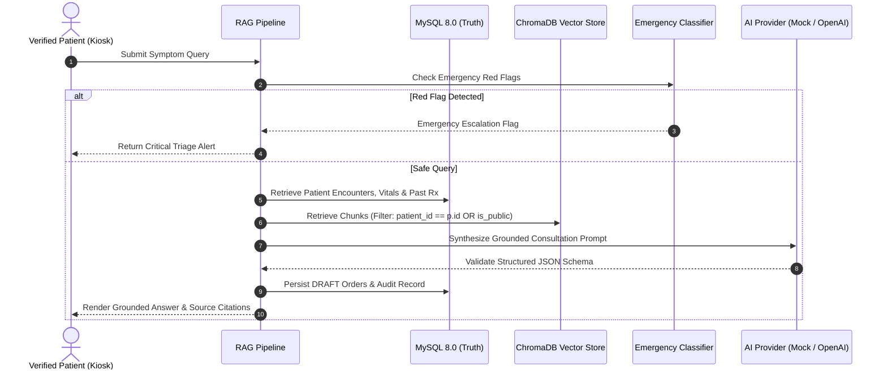

# Digital Doctor: AI Engine & RAG Retrieval Design

## 1. Design Overview

The Digital Doctor AI subsystem provides clinical decision support grounded in the patient's verified hospital records and authorized clinical practice guidelines.

---

## 2. Core Pillars

### 2.1 Multi-Layered Patient Authorization Boundary
Vector search queries must NEVER retrieve cross-patient records.
In `VectorStoreService.search_authorized`:
- Metadata contains `patient_id` and `is_public`.
- Queries strictly filter `patient_id == current_patient_id OR is_public == True`.
- Verified in automated test suite (`test_vector_store_strict_patient_boundary`).

### 2.2 Provider Abstraction
The system supports two swappable providers behind `AIProviderBase`:
1. **`MockAIProvider`**: Deterministic, offline-compatible, rule-grounded simulator generating structured JSON outputs in English and Tamil without requiring cloud API keys.
2. **`OpenAIProvider`**: Cloud provider utilizing `gpt-4o-mini` with bounded retries, timeouts, and JSON mode schema validation.

### 2.3 Strict Response Contract (`StructuredAIResponse`)
Every AI output contains:
- `answer`: Grounded conversational explanation.
- `answer_language`: Language code (`en` or `ta`).
- `symptom_summary`: Clean summary of extracted complaints.
- `relevant_history`: Past diagnoses and active medications reviewed.
- `source_references`: Array of citations (title, date, author, record type, summary).
- `uncertainties`: Explicit acknowledgment of diagnostic limits.
- `suggested_next_steps`: Follow-up recommendations.
- `requires_clinician_review`: Always `True` for clinical orders.
- `draft_orders`: Un-dispensable draft orders awaiting clinician approval.
