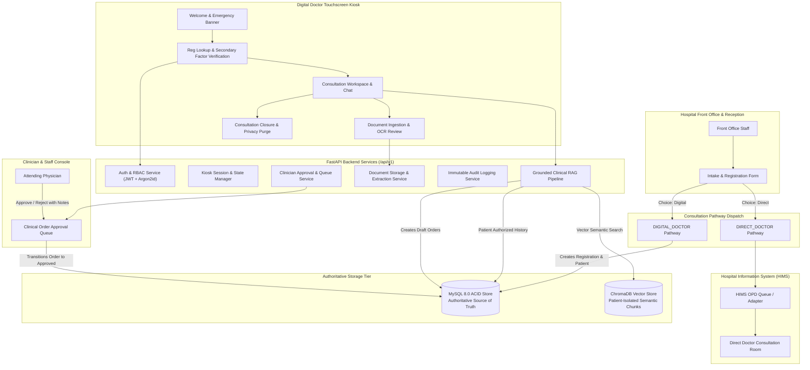
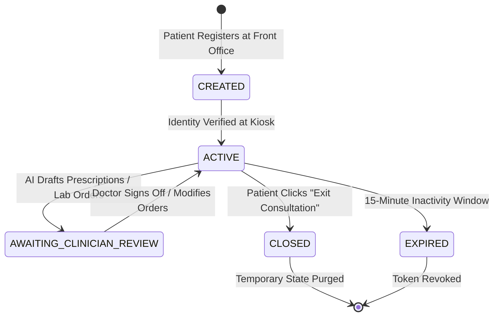

# Digital Doctor: System Architecture & Design Specification

## 1. High-Level System Architecture

Digital Doctor is a hospital self-service consultation kiosk system integrated with an authoritative hospital backend and supervised by licensed attending clinicians.

---

## 2. Core Subsystems

### 2.1 Front-Office Dual Pathway Dispatch
Hospital outpatient workflows require direct clinician consultations to operate unimpeded. Digital Doctor implements an explicit dual-pathway registration mechanism:
1. **`DIRECT_DOCTOR`**: Sent exclusively to the `MockHIMSAdapter`. No Digital Doctor session is initialized, and no kiosk access is provisioned.
2. **`DIGITAL_DOCTOR`**: Generates a unique registration token (`DD-YYYYMM-XXXXXX`), hashes a secondary verification factor (DOB/PIN), links previous encounter history, and marks the registration as kiosk-eligible.

### 2.2 Kiosk Session Lifecycle & Privacy State Machine

- **Verification Gate**: Registration ID entry returns masked patient initials. Full clinical details are strictly hidden until the patient supplies their secondary factor.
- **Short-Lived Tokens**: Kiosk JWT tokens are issued with a 15-minute maximum lifetime and scoped strictly to the verified patient's record.
- **Atomic Reset**: On consultation completion, all temporary browser cookies, local state, and uploaded previews are wiped from the kiosk client, returning the interface to the Welcome screen.

### 2.3 Retrieval-Augmented Generation (RAG) Architecture
The Digital Doctor AI Subsystem operates on strict clinical grounding principles:
1. **Authoritative Source**: MySQL is the authoritative record store. ChromaDB is a derived search index.
2. **Patient Isolation Filter**: When querying vector chunks, the retrieval filter mandates `patient_id == current_session.patient_id OR is_public == True`. Chunks indexed for other patients are cryptographically and logically excluded.
3. **Structured Pydantic Contract**: The LLM output is parsed into `StructuredAIResponse` schema, containing grounded references, uncertainties, symptom summaries, and draft orders.
4. **Resilient Provider Interface**: Seamlessly toggles between the deterministic `MockAIProvider` (zero-cost offline development) and the `OpenAIProvider` (cloud model integration).

### 2.4 Human-In-The-Loop (HITL) Safety Guard
- The AI never issues active prescriptions or orders.
- Recommendations originate in `DRAFT_PENDING_REVIEW` status.
- Only authenticated physicians possessing the `DOCTOR` or `ADMIN` role can sign off on medication dispensing or diagnostic requests.
