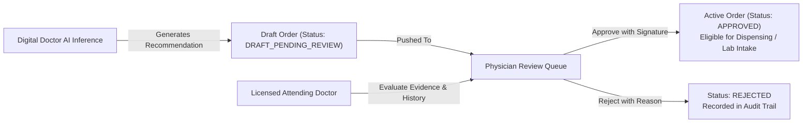

# Digital Doctor: Clinical Safety & Physician Oversight Governance

## 1. Regulatory Context & Decision Support Scope

Digital Doctor is architected strictly as **Clinical Decision-Support Software (CDSS)**. It is NOT an autonomous medical practitioner. Under applicable healthcare regulations, AI models cannot independently prescribe pharmaceuticals, authorize radiological exposures, issue invasive laboratory tests, or confirm clinical diagnoses.

---

## 2. Mandatory Human-In-The-Loop (HITL) Architecture

1. **State Isolation**: When the AI suggests medications or laboratory diagnostics, they are persisted exclusively in `DRAFT_PENDING_REVIEW` status.
2. **Dispensing Prevention**: The pharmacy and laboratory modules reject any order that does not carry `ReviewStatus.APPROVED` signed by an authorized physician.
3. **Audit Provenance**: Every approval or rejection is immutably logged with the doctor's user ID, license number, timestamp, and optional clinical rationale.

---

## 3. Emergency Triage Rules

The system runs an active regex and semantic safety classifier (`EmergencyClassifier`) across all inbound patient queries before LLM inference.

Configured Red Flags:
- **Cardiovascular**: Acute retrosternal chest pain, radiating pain to left arm or jaw, suspected myocardial infarction.
- **Respiratory**: Severe acute dyspnea, cyanosis, gasping for air.
- **Neurological**: Unilateral facial droop, slurred speech, sudden hemiparesis (FAST protocol).
- **Hemorrhagic**: Uncontrolled active bleeding, hemoptysis, hematemesis.

**Response Behavior**:
When an emergency rule is triggered:
- The AI consultation is immediately paused.
- The interface renders a persistent crimson warning banner.
- High-priority instructions direct the patient to the hospital Emergency Room / Triage Desk (Room 101).
- The safety event is recorded in the audit log.
