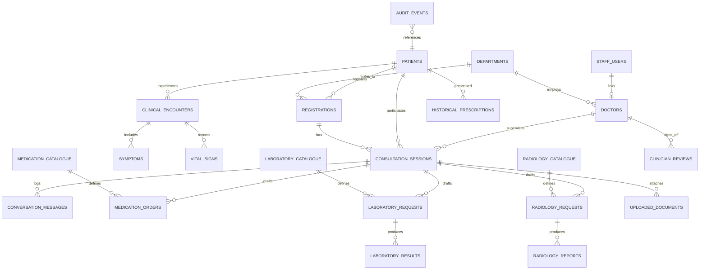

# Digital Doctor: Relational Database Schema Specification

## 1. Schema Overview

The Digital Doctor relational schema runs on MySQL 8.0 with InnoDB engine and `utf8mb4` encoding. It contains 23 normalized tables enforcing referential integrity, explicit audit provenance, and patient isolation.

---

## 2. Table Catalog

| Table Name | Primary Purpose | Key Columns |
| :--- | :--- | :--- |
| `departments` | Hospital administrative clinical departments | `id`, `code` (UQ), `name`, `is_active` |
| `staff_users` | Authenticated hospital personnel with role claims | `id`, `username` (UQ), `email` (UQ), `hashed_password`, `role` |
| `doctors` | Licensed physician profiles linked to staff credentials | `id`, `employee_id` (UQ), `license_number` (UQ), `department_id` |
| `patients` | Authoritative master patient demographics | `id`, `mrn` (UQ), `first_name`, `last_name`, `date_of_birth`, `contact_phone` |
| `registrations` | OPD visits with explicit pathway routing | `id`, `registration_number` (UQ), `consultation_type`, `status`, `secondary_verification_hash` |
| `consultation_sessions` | Kiosk consultation session state machine | `id`, `session_id` (UUID UQ), `registration_id`, `status`, `language_preference` |
| `conversation_messages` | Inbound patient and outbound AI structured replies | `id`, `session_id`, `sender_type`, `message_text`, `structured_payload_json` |
| `clinical_encounters` | Doctor-patient consultation encounter summaries | `id`, `patient_id`, `doctor_id`, `encounter_date`, `chief_complaint`, `provenance_source` |
| `symptoms` | Specific complaints recorded during encounters | `id`, `encounter_id`, `patient_id`, `symptom_name`, `severity` |
| `vital_signs` | Physiologic measurements | `id`, `encounter_id`, `patient_id`, `systolic_bp`, `diastolic_bp`, `heart_rate`, `sp_o2` |
| `historical_prescriptions` | Past clinician-authored medication history | `id`, `patient_id`, `medication_name`, `dosage`, `frequency`, `duration` |
| `medication_catalogue` | Approved hospital formulary drugs | `id`, `code` (UQ), `brand_name`, `generic_name`, `dosage_form`, `standard_strength` |
| `medication_orders` | Prescriptions originating from consultation drafts | `id`, `session_id`, `patient_id`, `medication_name`, `dosage`, `review_status`, `reviewed_by_doctor_id` |
| `laboratory_catalogue` | Diagnostic laboratory test menu | `id`, `test_code` (UQ), `test_name`, `category`, `reference_range`, `specimen_type` |
| `laboratory_requests` | Requisitions for lab investigations | `id`, `session_id`, `patient_id`, `test_name`, `urgency`, `review_status` |
| `laboratory_results` | Verified lab analysis findings | `id`, `request_id`, `patient_id`, `test_name`, `result_value`, `is_abnormal` |
| `radiology_catalogue` | Diagnostic imaging procedure catalog | `id`, `procedure_code` (UQ), `procedure_name`, `modality`, `body_part` |
| `radiology_requests` | Imaging requisition orders | `id`, `session_id`, `patient_id`, `procedure_name`, `review_status` |
| `radiology_reports` | Radiologist interpretation reports | `id`, `request_id`, `patient_id`, `modality`, `findings`, `impression`, `is_abnormal` |
| `uploaded_documents` | Scanned reports and medical media | `id`, `document_uuid` (UQ), `stored_filename`, `mime_type`, `ocr_extracted_text`, `processing_status` |
| `ai_recommendations` | Raw structured AI inference outputs | `id`, `session_id`, `recommendation_type`, `content_json`, `emergency_flag` |
| `clinician_reviews` | Physician approval/rejection audit log | `id`, `item_type`, `item_id`, `reviewing_doctor_id`, `action`, `notes` |
| `audit_events` | Immutable security and access event stream | `id`, `event_type`, `actor_type`, `actor_id`, `resource_type`, `action_details` |
